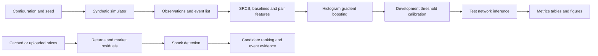

# Inferring Hidden Economic Connections from Financial Shock Propagation

## A Synthetic and Real Data Prototype

**Student:** [STUDENT NAME AND ID]

**Guide:** [GUIDE NAME]

**Department and institution:** [INSTITUTIONAL DETAILS]

**Academic year:** [ACADEMIC YEAR]

> Submission certificates, declarations, signatures and institution-specific formatting remain placeholders pending official details.

## Abstract

Economic relationships between companies are often incomplete, private or difficult to observe directly. This project tests whether repeated delayed responses after company-specific financial shocks contain useful evidence about an unobserved connection network. The prototype creates sparse synthetic networks and introduces the interpretable Shock-Response Connectivity Score (SRCS). A histogram gradient-boosting classifier learns a nonlinear combination of 15 pair-level response, correlation, predictive, coverage and volatility features. Complete networks are separated into training, calibration and test seed groups. Reference methods include random ranking, Pearson correlation, maximum lagged correlation, pairwise Granger-style predictive gain and deterministic SRCS. A real-price pipeline ranks candidates without claiming causality. The implementation includes reproducible scripts, raw result tables, tests and an offline-capable Streamlit dashboard.

## 1 Introduction

Networks offer a compact representation of systems in which entities interact. In an economic network, nodes may represent firms and edges may represent supply, ownership, financing, technological or other dependencies. Direct edge data may be incomplete or unavailable, motivating network reconstruction from observed behavior. Financial network reconstruction is an established problem precisely because private interconnections limit direct measurement [1].

This work studies a controlled prototype rather than a general discovery system. Its central question is whether conditioning on repeated source-company shocks adds useful information beyond unconditional co-movement. Synthetic data provides the only ground truth. Real prices support an exploratory demonstration and produce ranked candidates only.

### 1.1 Objectives

The project aims to implement an end-to-end reproducible benchmark, compare SRCS with simple alternatives, measure robustness and expose the evidence through a dashboard suitable for a university demonstration.

### 1.2 Contributions

The implementation contributes an event-conditioned score, domain-randomized ML training data, seed-level train/calibration/test separation, an ML edge-probability model, edge-level ranking metrics, three repeated robustness studies, a provenance-aware real-data path and an auditable event-evidence export.

## 2 Literature Review

Network science formalizes systems as nodes and edges and studies both topology and processes that unfold over it [2]. Reconstruction methods estimate missing structure from partial observations. Anand and co-authors survey reconstruction in economic and financial systems and emphasize that different assumptions can produce different inferred networks [1].

Event studies measure price behavior around identified events and motivate careful separation of expected and abnormal returns [3]. The present prototype borrows the event-conditioning idea but does not estimate announcement effects or make causal claims. The market model removes a linear common component before shock detection.

Granger's predictive definition asks whether past values from one series improve predictions of another [4]. The baseline implemented here uses the relative residual-sum-of-squares improvement from adding lagged source values to an autoregression of the target. It is described as “Granger-style” because the prototype records a predictive score rather than a full inferential test with diagnostic assumptions.

Pearson correlation and lagged correlation are useful references but can reflect shared factors, persistence or simultaneous news. SRCS attempts to focus the comparison on repeated source-specific extreme observations.

## 3 Problem Definition and Mathematical Background

Let an unobserved network contain \(n\) companies and adjacency matrix \(A\), where \(A_{ij}=A_{ji}\), \(A_{ii}=0\) and \(A_{ij}\in\{0,1\}\). Synthetic company states evolve as

\[
x_{t+1}=\alpha x_t+\beta D^{-1}Ax_t+s_{t+1}+\epsilon_{t+1},
\]

where \(\alpha\) is persistence, \(\beta\) is propagation strength, \(D^{-1}A\) is the row-normalized adjacency matrix, \(s_t\) contains sparse signed shocks and \(\epsilon_t\) is Gaussian noise. The implementation requires \(\alpha+\beta<1\) as a conservative stability condition.

For a source event \(e=(t,i,m)\), responder \(j\), maximum lag \(L\), standardized observation \(z\), and decay \(\lambda\), event response strength is

\[
r_{e,i\rightarrow j}=\max_{1\leq \ell\leq L}\left[e^{-\lambda(\ell-1)}\max(0,\operatorname{sign}(m)z_{t+\ell,j})\right].
\]

The directed score multiplies mean response by the fraction of event responses above threshold \(\tau_r\):

\[
Q_{i\rightarrow j}=\overline{r}_{i\rightarrow j}\cdot \frac{1}{|E_i|}\sum_{e\in E_i}\mathbf{1}[r_e\geq\tau_r].
\]

The undirected SRCS is \(Q_{ij}=(Q_{i\rightarrow j}+Q_{j\rightarrow i})/2\). A calibrated score threshold produces a binary inferred adjacency. Calibration accesses only development truth; inference itself receives observations and events, not \(A\).

## 4 Proposed System Design

The system separates scientific computation from presentation. Reusable modules implement simulation, preprocessing, detection, scoring, baselines, thresholding and evaluation. Experiment entry points store raw trials, summaries, configurations and figures. The dashboard calls these modules rather than duplicating equations.

## 5 Methodology

Synthetic training, calibration and test seeds never overlap. Whole networks, rather than individual pair rows, are assigned to a split. Forty training networks span randomized company counts, densities, persistence, propagation, noise, shock sizes and shock counts; ten separate networks calibrate thresholds and ten evaluate final performance. Every method receives the same test observations. Precision, recall and F1 count the strict upper triangle once. ROC-AUC and average precision use continuous scores where both classes exist.

The robustness design changes one primary factor at a time. Noise standard deviation, propagation strength and shock count each have four settings. Ten independent development/test seed pairs are used per setting in the full run. Reports include mean and sample standard deviation.

For real prices, dates are aligned, short missing gaps are forward-filled, log returns are computed and each company is regressed on the chosen market index. Residuals become abnormal returns and are standardized by company. Events require \(|z|\geq2.5\), a five-observation cooldown and enough future observations for a complete response window.

## 6 Implementation

Python modules use NumPy and pandas for numerical work and scikit-learn for ranking metrics and `HistGradientBoostingClassifier`. The classifier uses balanced class weights, 15 leaves, a minimum of 12 samples per leaf, learning rate 0.05 and L2 regularization 1.0. NetworkX supports network representations, Matplotlib saves scientific figures, and Plotly plus Streamlit provide interaction. All random behavior uses explicit seeds. Invalid shapes, unstable coefficients, non-finite values, impossible shock schedules, split leakage and missing data produce explicit errors.

The dashboard contains overview, synthetic experiment, shock detection, inferred network, method comparison, real-data analysis, and methodology/limitations pages. It can load the packaged cache without internet access and permits a user-supplied adjusted-price CSV.

## 7 Experimental Setup and Results

The default synthetic experiment uses ten companies, 260 time steps, edge probability 0.22, persistence 0.20, propagation 0.55, noise standard deviation 0.10, shock size 2.5 and 30 events. Development seeds are distinct from test seeds. The results below were generated from the recorded configuration and remain linked to raw CSV files under `reports/results/`.

### 7.1 Baseline comparison

Across ten independent, domain-randomized test networks, the ML classifier achieved mean F1 0.930 (SD 0.081), ROC-AUC 0.988 and PR-AUC 0.982. Deterministic SRCS achieved F1 0.838 (SD 0.126), followed by Granger-style gain at 0.783, lagged correlation at 0.688, Pearson at 0.456 and random ranking at 0.371. Pair features use direction-invariant minimum, maximum and asymmetry summaries so arbitrary company numbering cannot change an undirected prediction. Held-out permutation analysis ranked Granger gain and minimum/maximum event-response strength highest. These results demonstrate recovery across unseen simulator regimes, not verified accuracy on real economic relationships.

The comparison must be reported without assuming SRCS wins. ROC-AUC evaluates ranking across false-positive rates, while average precision is informative for sparse positive edges. Thresholded F1 measures the calibrated classification decision.

### 7.2 Robustness

Noise reduced SRCS performance at the highest tested setting: mean F1 fell from 0.953 at noise 0.05 to 0.777 at noise 0.35. Stronger propagation improved recoverability from mean F1 0.649 at strength 0.20 to 0.978 at 0.55; performance at 0.70 remained high at 0.961. Increasing events from 10 to 30 improved mean F1 from 0.883 to 0.978, while 40 events produced 0.944. Every setting used ten independent development seeds and ten independent test seeds.

Interpretation should distinguish a change in mean performance from variability across seeds. Small networks can show considerable metric variance because a few edge decisions materially change precision or recall.

### 7.3 Real-data demonstration

The verified cache contains 1,003 adjusted daily closing-price observations from 3 January 2022 through 31 December 2025. It covers ten US-listed companies and SPY, with Yahoo Finance via `yfinance` recorded as the source. The detector found 196 events. GOOGL-AMZN ranked first by ML probability at 0.1607, followed by MSFT-META at 0.1273; NVDA-XOM ranked last at 0.0010. All were below the synthetic calibration cutoff of 0.3005. The cutoff was not lowered after viewing real results. These rankings may reflect shared sectors or news and do not establish direct economic links.

Two high-ranked cases and one lower or ambiguous case should be discussed only when the cached observations support them. An ambiguous case is scientifically useful because a high market response can arise from shared sector exposure or news rather than a direct economic relationship.

## 8 Testing and Deployment

Thirty-three tests cover simulator reproducibility and validation, zero-variance standardization, event windows, thresholding, single-count metrics, every baseline, ML feature extraction, company-relabel invariance, corpus determinism, split-leakage rejection, probability symmetry, preprocessing, shock cooldowns, cache provenance and independent calibration-to-inference paths. GitHub Actions installs the dependencies, runs the tests and quick experiments, and starts Streamlit headlessly.

The Docker image uses Python 3.12 and exposes port 8501. Streamlit Community Cloud deployment requires selecting this repository and `app.py`; no runtime secret is required for cached data. External data refresh remains a separate online action.

## 9 Limitations Ethics and Risks

The synthetic data-generating process is linear and static. The classifier can therefore learn simulator assumptions rather than real economics. Pair rows from one graph are dependent, even though seed-level splitting prevents direct leakage. Real economic connections may be directed, time-varying and nonlinear. Market residualization removes only a linear common component. Extreme observations may reflect earnings, macroeconomic news, data errors or volatility changes. Multiple candidate pairs increase spurious-ranking risk. Neither Granger-style prediction nor an ML probability establishes structural causality.

Ethically, the dashboard must avoid presenting inferred links as facts about companies. Users should retain provenance, dates and uncertainty and should validate candidates against independent public evidence. The system is an educational research prototype, not investment advice.

## 10 Conclusion and Future Work

The project establishes a reproducible hybrid method: interpretable event-conditioned measurements are combined by a nonlinear supervised classifier, while known ground truth remains restricted to synthetic labels. The real-data extension organizes candidate evidence while preserving a strict interpretation boundary. Future work should acquire point-in-time real relationship labels, evaluate probability calibration and temporal transfer, and add sector controls, uncertainty intervals and multiple-testing correction before considering sequence encoders or graph neural networks.

## References

1. Anand, K., van Lelyveld, I., Banai, Á., Friedrich, S., Garratt, R., Hałaj, G., Fique, J., Hansen, I., Jaramillo, S. M., Lee, H., Molina-Borboa, J. L., Nobili, S., Rajan, S., Salakhova, D., Silva, T. C., Silvestri, L., and de Souza, S. R. S. (2018). Reconstruction methods for networks: The case of economic and financial systems. *Physics Reports*, 757, 1–47. https://doi.org/10.1016/j.physrep.2018.06.008
2. Newman, M. E. J. (2010). *Networks: An Introduction*. Oxford University Press. https://doi.org/10.1093/acprof:oso/9780199206650.001.0001
3. MacKinlay, A. C. (1997). Event studies in economics and finance. *Journal of Economic Literature*, 35(1), 13–39. https://doi.org/10.1257/jel.35.1.13
4. Granger, C. W. J. (1969). Investigating causal relations by econometric models and cross-spectral methods. *Econometrica*, 37(3), 424–438. https://doi.org/10.2307/1912791

## Appendices

### Appendix A Reproduction commands

See `README.md` and `reports/DEMO_SCRIPT.md`.

### Appendix B Institutional placeholders

- Certificate text and signatures
- Student roll number and division
- Guide and head-of-department approval
- College logo and mandated page layout
- Similarity report and submission date
